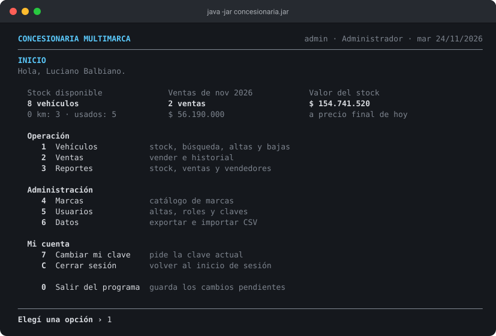
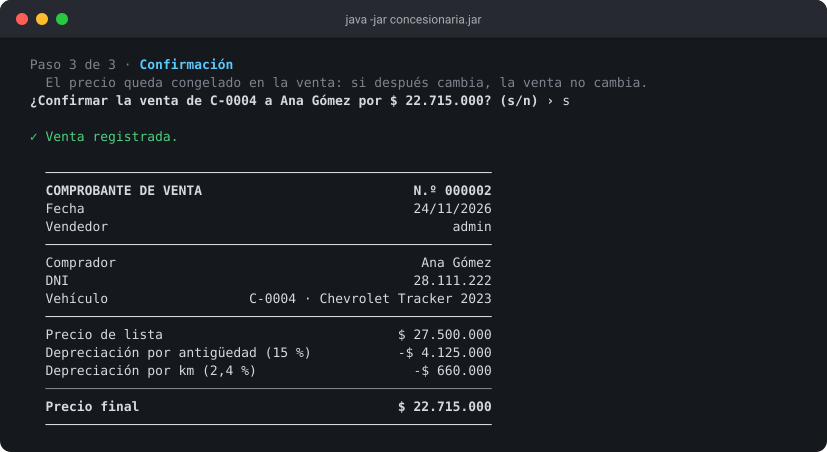
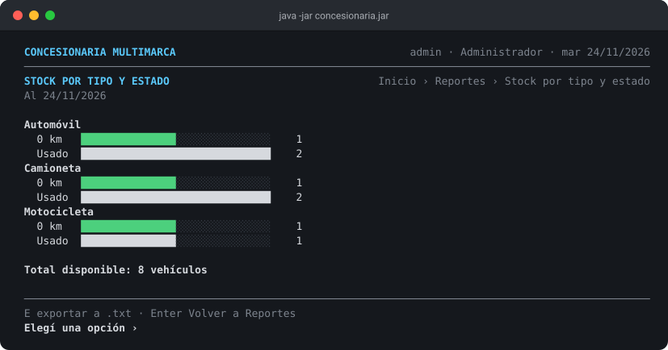

# Concesionaria multimarca

Sistema de consola en **Java SE 25 puro** para una concesionaria que vende automóviles,
camionetas y motocicletas, 0 km y usados. Gestiona el stock, calcula el precio final de cada
unidad, registra las ventas, genera reportes para los directivos y restringe las operaciones de cada
usuario según su rol.

[](https://openjdk.org/projects/jdk/25/)

-16a34a)
[](https://github.com/BalbianoLuciano/tfi-concesionaria-multimarca/releases/latest)

> **Trabajo Final Integrador de Programación II** · Tecnicatura Universitaria en Programación,
> UTN Facultad Regional Resistencia, 2026.
>
> La consigna requiere integrar los contenidos de la asignatura en un caso de aplicación,
> con énfasis en la interacción con el usuario. En consecuencia, el sistema prioriza una
> interfaz de consola cuidada, desarrollada sin frameworks ni librerías externas.



---

## Ejecución

Se requiere un JDK 25 o posterior. El archivo `concesionaria.jar` se obtiene del
[último release](https://github.com/BalbianoLuciano/tfi-concesionaria-multimarca/releases/latest)
y se ejecuta con:

```bash
java -Dconcesionaria.dir=/tmp/demo -jar concesionaria.jar
```

En el primer arranque el sistema crea el usuario administrador y ofrece cargar datos de
demostración (8 marcas y 10 vehículos). Si no se indica `-Dconcesionaria.dir`, los datos se
almacenan en `~/.concesionaria/`. La opción `--sin-color` (o la variable de entorno
`NO_COLOR`) desactiva los códigos de color.

A partir del código fuente:

```bash
./build.sh run              # compila con javac --release 25, arma el .jar y lo ejecuta
./build.sh test             # 87 pruebas con un runner propio, sin JUnit
./build.sh test PR-PRECIO   # un solo grupo
./build.sh docs             # JavaDoc en dist/javadoc/
./build.sh bench            # mediciones de rendimiento con 10.000 vehículos
```

---

## Interfaz de consola

Todas las pantallas responden a una estructura común, definida en la especificación antes
de su implementación: encabezado fijo, título con la ruta de navegación, una línea de
contexto, opciones con su descripción y teclas de salida en una posición constante, con
indicación de su destino.

**Stock agrupado por tipo**, con la cantidad y el valor de cada grupo. Las unidades 0 km se
destacan en verde, y los filtros y el criterio de orden vigentes se informan en la parte
superior.


**Alta en cuatro pasos.** Antes de cada campo se indica el formato esperado. Ante un dato
inválido, el mensaje de error explica cómo corregirlo y el campo se solicita nuevamente,
hasta tres veces. La marca no se escribe libremente: se ingresan sus primeras letras y se
selecciona del catálogo, lo que evita que variantes como "Toyota", "TOYOTA" y "Toyta" se
registren como marcas distintas.


<table>
<tr>
<td width="50%" valign="top">

**Ficha** en dos columnas, con el desglose del precio: cada descuento y recargo con su porcentaje.


</td>
<td width="50%" valign="top">

**Venta** con confirmación, precio fijado al momento de la operación y comprobante.



**Reportes** para directivos, con gráficos de barras y exportación a `.txt`.



</td>
</tr>
</table>

El color tiene siempre un significado: verde indica éxito o unidad 0 km; rojo, error;
amarillo, advertencia; cian, título. Nunca es la única señal, ya que se acompaña de los
símbolos ✓, ✗ y !, por lo que la versión sin color transmite la misma información.

---

## Arquitectura

El sistema se organiza en tres capas con dependencias en un único sentido. La capa de
presentación desconoce cómo se almacenan los datos, y la capa de negocio desconoce la
existencia de la consola.


```
src/ar/edu/utn/frre/concesionaria/
├── App.java       arma las dependencias a mano y arranca
├── presentacion/  consola (Terminal, Lector, Tabla, Estilo) y una pantalla por área
├── negocio/       servicios, Sesion con la matriz de permisos, filtros y órdenes
├── datos/         repositorios en memoria, archivo con escritura atómica, CSV, datos demo
├── modelo/        Vehiculo y subclases, Marca, Venta, Usuario, enums, interfaces
├── excepciones/   ConcesionariaException y sus 13 hijas
└── comun/         formatos argentinos, textos sin acentos, reloj fijable
```

Esta separación tiene una consecuencia práctica: dado que la capa de negocio recibe
interfaces por constructor, las pruebas la instancian completa en memoria, con una
persistencia simulada capaz de reproducir una falla de disco durante una venta.

### Cálculo del precio: método plantilla


El método `desglosarPrecio()` se declara `final`, de modo que ninguna subclase puede alterar
el orden de los pasos. Cada tipo de vehículo define únicamente su depreciación por año y por
kilómetro, sus recargos y su costo de patentamiento. El polimorfismo determina *cuánto*; la
clase base determina *cómo*. Todos los importes se representan con `BigDecimal` y se
redondean a pesos enteros.

### Persistencia con escritura atómica


---

## Decisiones de diseño

| Decisión | Fundamento | Alternativas descartadas |
|---|---|---|
| **Java SE puro, sin dependencias** | La consigna evalúa los contenidos de la asignatura. Todo elemento ajeno al programa se justifica en [SPEC §7](docs/SPEC.md) y se señala con un comentario en el código. | Maven, JUnit, librerías de consola como Lanterna |
| **Consola en lugar de interfaz gráfica** | Es el medio solicitado por la cátedra. Una consola bien diseñada exige los mismos criterios que una interfaz gráfica: jerarquía visual, validación inmediata y mensajes de error comprensibles. | Swing, JavaFX, una API web |
| **Un solo archivo para todo** | Una venta modifica simultáneamente vehículos y ventas. Con un archivo por colección, una interrupción entre ambos guardados dejaría el stock y las ventas en un estado inconsistente. | Un `.ser` por colección, una base de datos embebida |
| **Escribir a un temporal y mover** | `ATOMIC_MOVE` garantiza que en disco exista siempre la versión anterior o la nueva, nunca una parcial. La copia `.bak` cubre el caso de un archivo dañado. | Sobrescribir directo |
| **Marca como entidad, no como texto** | Si la marca se escribiera en cada alta, los reportes por marca perderían validez. El catálogo normaliza el nombre y advierte sobre marcas similares. | Un `String` libre, un enum fijo de marcas |
| **Precio por subclase con método plantilla** | Las reglas varían según el tipo, pero el orden de los pasos es invariable. De este modo, una subclase nueva no puede omitir el redondeo ni aplicar el patentamiento a una unidad usada. | Un `switch` por tipo, una tabla de precios cargada a mano |
| **Setters que validan** | Cada regla se define en un único lugar y la aplican por igual la consola, el importador CSV y las pruebas. No es posible construir un objeto inválido. | Validar solo en la pantalla |
| **Permisos en el negocio, no en el menú** | La consola oculta las operaciones no permitidas para el rol, pero cada servicio las verifica nuevamente con `sesion.exigir(...)`. Ocultar una opción no constituye un control de seguridad. | Controlar el acceso solo desde el menú |
| **Excepciones propias chequeadas** | El compilador obliga a tratar cada error, y su mensaje es el que se presenta al usuario; por ello cada uno indica cómo corregir el dato. | `RuntimeException` genéricas, códigos de error |
| **Wrappers en el modelo** | `null` representa un valor aún no cargado, situación que un `int` no permite distinguir de un cero. | Primitivos con valores centinela como `-1` |
| **Claves con SHA-256 y sal** | El archivo de datos no debe permitir la lectura de las claves de los usuarios. | Guardarlas en texto plano |
| **Medir antes de optimizar** | Se presumía que el cuello de botella sería guardar el archivo completo en cada cambio (12,6 ms con 10.000 vehículos). La medición mostró que estaba en un comparador, que pasó de 89 ms a 7 ms. | Optimizar sin mediciones previas |

El registro completo de decisiones, con fecha y contexto, se encuentra en [CONTEXTO.md](CONTEXTO.md).

---

## Rendimiento

El comando `./build.sh bench` genera datos con semilla fija, realiza 5 iteraciones de
calentamiento y registra la mediana de 20 repeticiones (Apple M4, JVM 27):

| Escenario, con 10.000 vehículos | Medido | Objetivo |
|---|--:|--:|
| Guardar todo el archivo (1,4 MB) | 12,6 ms | < 500 ms |
| Arrancar: leer y armar índices | 13,4 ms | < 1 s |
| Listar, filtrar y ordenar por precio | 2,6 ms | < 100 ms |
| Listar en orden natural | 7,1 ms | < 100 ms |

Con 100.000 vehículos, mil búsquedas por código demoran 0,037 ms mediante el `HashMap` y
155,8 ms recorriendo un `ArrayList`, es decir, unas **4.200 veces** más.

---

## Metodología

Se aplicó una versión liviana de **Spec-Driven Development**: la especificación precede al
código, y toda funcionalidad no contemplada se incorpora primero a la especificación. Cada
requisito de la consigna está trazado a las clases que lo implementan y a las pruebas que lo
verifican.

El código se integró mediante **pull requests**, uno por etapa, cada uno con su descripción,
comentarios de revisión en las líneas relevantes y la totalidad de las pruebas aprobadas
antes de la integración:

| PR | Etapa | Pruebas |
|---|---|--:|
| [#1](../../pull/1) | Especificación SDD completa | — |
| [#2](../../pull/2) | Build, runner de pruebas y modelo del dominio | 43 |
| [#3](../../pull/3) | Datos: repositorios, persistencia atómica y CSV | 55 |
| [#4](../../pull/4) | Negocio: permisos, venta todo o nada, reportes | 87 |
| [#5](../../pull/5) | Consola por rol y `App` | 87 |
| [#6](../../pull/6) | Medición de rendimiento y optimización | 87 |
| [#7](../../pull/7) · [#8](../../pull/8) · [#9](../../pull/9) | Rediseño de la interfaz en tres partes | 87 |
| [#10](../../pull/10) | Informe de entrega | 87 |
| [#11](../../pull/11) · [#12](../../pull/12) | README y notas del release | 87 |

Por tratarse de un trabajo individual, el autor cumplió todos los roles del proceso de revisión, como ilustra la siguiente imagen.


---

## Documentación

| Documento | Contenido |
|---|---|
| [docs/SPEC.md](docs/SPEC.md) | 17 casos de uso, validaciones, reglas de precio, criterios de la consola, contenido extra y plan de pruebas |
| [docs/MODELO.md](docs/MODELO.md) | Jerarquía de clases, enums, interfaces y excepciones |
| [docs/ARQUITECTURA.md](docs/ARQUITECTURA.md) | Capas, flujo de una operación, persistencia, seguridad y rendimiento medido |
| [docs/TRAZABILIDAD.md](docs/TRAZABILIDAD.md) | Requisito de la consigna → clase → prueba |
| [CONTEXTO.md](CONTEXTO.md) | Cada decisión tomada y su porqué |
| [docs/informe/](docs/informe/) | Informe de entrega con la carátula oficial |

---

<sub>Luciano Balbiano · [github.com/BalbianoLuciano](https://github.com/BalbianoLuciano) ·
[balbianoluciano.github.io](https://balbianoluciano.github.io) · Programación II, TUP UTN
FRRe, 2026.</sub>
