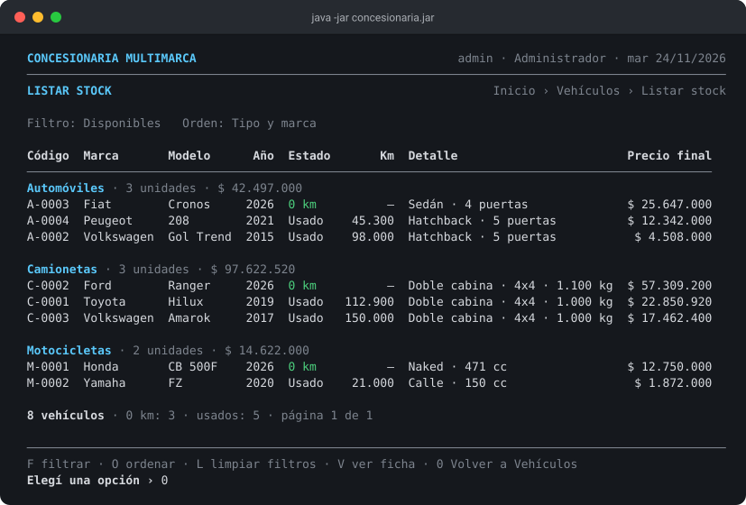
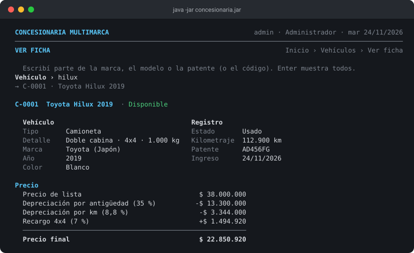
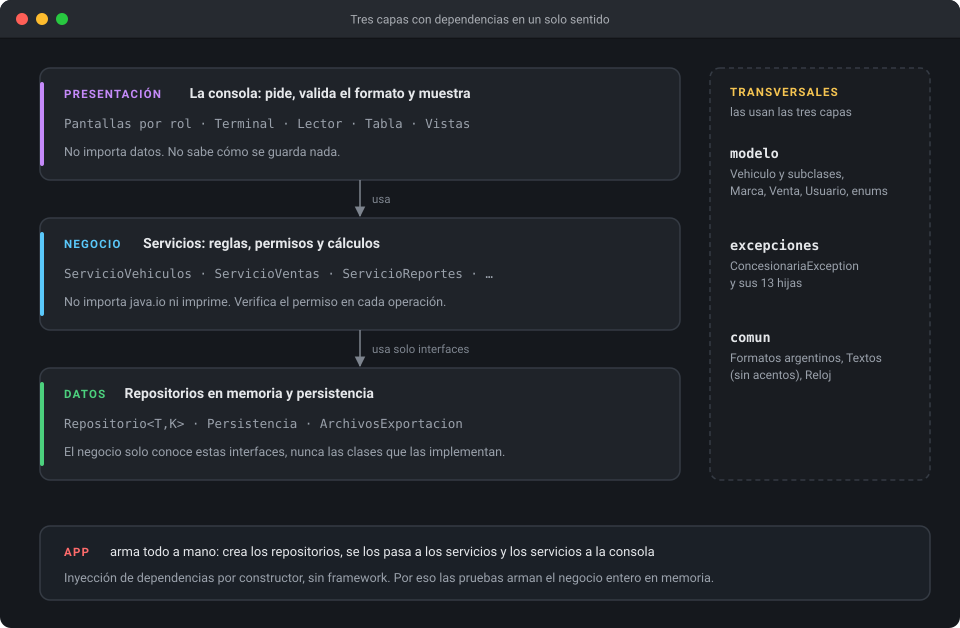
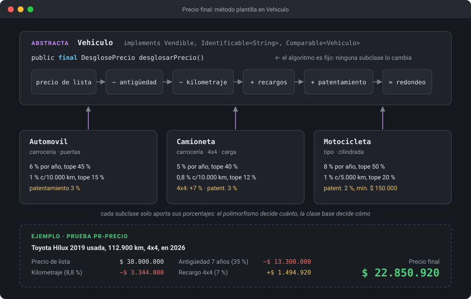
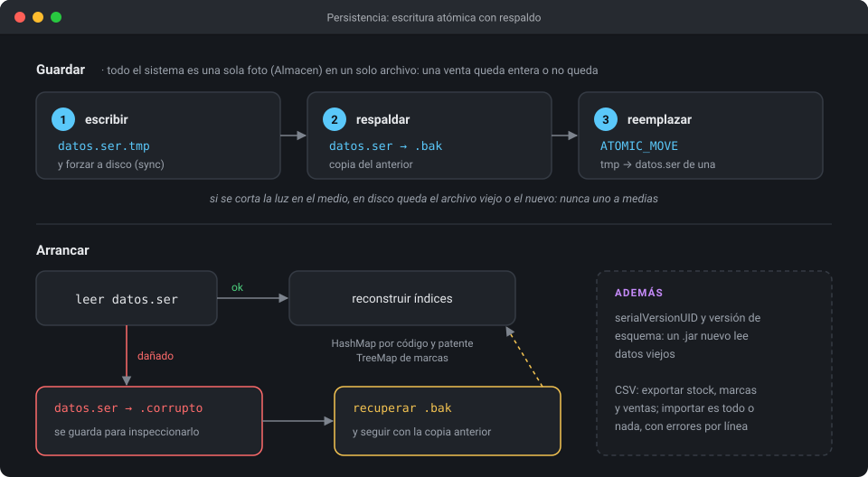

# Concesionaria multimarca

Sistema de consola en **Java SE 25 puro** para una concesionaria que vende automóviles,
camionetas y motocicletas, 0 km y usados. Gestiona el stock, calcula el precio final de cada
unidad, registra ventas, arma reportes para los directivos y separa lo que puede hacer cada
usuario según su rol.

[](https://openjdk.org/projects/jdk/25/)

-16a34a)
[](https://github.com/BalbianoLuciano/tfi-concesionaria-multimarca/releases/latest)

> **Trabajo Final Integrador de Programación II** · Tecnicatura Universitaria en Programación,
> UTN Facultad Regional Resistencia, 2026.
>
> La consigna pedía integrar los contenidos de la materia en un caso real y poner el énfasis
> en la interacción con el usuario. La respuesta fue una consola trabajada en serio: sin
> frameworks, sin librerías, y sin el típico menú de `System.out.println` que pide un número
> y vuelve a imprimirse debajo.


---

## Probalo en 30 segundos

Hace falta un JDK 25 o posterior. Bajá `concesionaria.jar` del
[último release](https://github.com/BalbianoLuciano/tfi-concesionaria-multimarca/releases/latest) y:

```bash
java -Dconcesionaria.dir=/tmp/demo -jar concesionaria.jar
```

En el primer arranque se crea el usuario administrador y se ofrecen datos de demostración
(8 marcas y 10 vehículos) para recorrer todo enseguida. Sin `-Dconcesionaria.dir`, los datos
quedan en `~/.concesionaria/`. Con `--sin-color` (o la variable `NO_COLOR`) la salida va sin
códigos de color.

Desde el código:

```bash
./build.sh run              # compila con javac --release 25, arma el .jar y lo ejecuta
./build.sh test             # 87 pruebas con un runner propio, sin JUnit
./build.sh test PR-PRECIO   # un solo grupo
./build.sh docs             # JavaDoc en dist/javadoc/
./build.sh bench            # mediciones de rendimiento con 10.000 vehículos
```

---

## Qué se ve en la consola

Todas las pantallas comparten un mismo esqueleto, definido en la especificación antes de
programar ninguna: encabezado fijo, título con la ruta de navegación, una línea de contexto,
opciones con descripción y las teclas de salida siempre en el mismo lugar, diciendo a dónde
llevan.

**Stock agrupado por tipo**, con cantidad y valor de cada grupo. Los 0 km en verde; los
filtros y el orden activos, arriba.



**Alta en cuatro pasos.** Antes de cada campo se dice qué formato se espera; si el dato está
mal, el error explica cómo corregirlo y se vuelve a pedir, hasta tres veces. La marca no se
tipea: se escriben las primeras letras y se elige del catálogo, así "Toyota", "TOYOTA" y
"Toyta" nunca terminan siendo tres marcas distintas.


<table>
<tr>
<td width="50%" valign="top">

**Ficha** en dos columnas y desglose del precio: cada descuento y recargo, con su porcentaje.



</td>
<td width="50%" valign="top">

**Venta** con confirmación, precio congelado y comprobante.


**Reportes** para directivos, con barras y exportación a `.txt`.


</td>
</tr>
</table>

El color siempre significa algo: verde es éxito o 0 km, rojo es error, amarillo es aviso,
cian es título. Nunca es la única señal (también hay ✓, ✗ y !), así que la versión sin color
dice exactamente lo mismo.

---

## Arquitectura

Tres capas, y las dependencias van en un solo sentido. La consola no sabe cómo se guardan
los datos; el negocio no sabe que hay una consola.



```
src/ar/edu/utn/frre/concesionaria/
├── App.java       arma las dependencias a mano y arranca
├── presentacion/  consola (Terminal, Lector, Tabla, Estilo) y una pantalla por área
├── negocio/       servicios, Sesion con la matriz de permisos, filtros y órdenes
├── datos/         repositorios en memoria, archivo con escritura atómica, CSV, datos demo
├── modelo/        Vehiculo y subclases, Marca, Venta, Usuario, enums, interfaces
├── excepciones/   ConcesionariaException y sus 13 hijas
└── comun/         formatos argentinos, textos sin acentos, reloj fijable
```

La separación no es decorativa: como el negocio recibe interfaces por constructor, las
pruebas lo arman completo en memoria, con una persistencia falsa que puede simular un disco
que falla justo en medio de una venta.

### El precio, con un método plantilla



`desglosarPrecio()` es `final`: el orden de los pasos no se puede romper desde una subclase.
Cada tipo de vehículo solo dice cuánto se deprecia por año y por kilómetro, qué recargos
tiene y cuánto cuesta patentarlo. El polimorfismo decide *cuánto*, la clase base decide
*cómo*. Toda la plata va en `BigDecimal` con redondeo a pesos enteros.

### Persistencia que no deja archivos a medias



---

## Decisiones de diseño, y por qué

| Decisión | Por qué | Lo que se descartó |
|---|---|---|
| **Java SE puro, sin dependencias** | La consigna evalúa lo visto en clase. Cada cosa fuera del temario está justificada en [SPEC §7](docs/SPEC.md) y tiene un comentario en el código que remite ahí. | Maven, JUnit, librerías de consola como Lanterna |
| **Consola en lugar de interfaz gráfica** | Es lo que la cátedra pidió trabajar. Una consola bien hecha exige lo mismo que una GUI: jerarquía visual, validación en el momento, errores que se entienden. | Swing, JavaFX, una API web |
| **Un solo archivo para todo** | Una venta modifica vehículos y ventas a la vez. Con un archivo por colección, un corte entre los dos guardados deja el stock y las ventas en desacuerdo. | Un `.ser` por colección, una base de datos embebida |
| **Escribir a un temporal y mover** | `ATOMIC_MOVE` hace que en disco haya siempre el archivo viejo o el nuevo, nunca uno a medias. El `.bak` cubre el caso de un archivo que llegó dañado. | Sobrescribir directo |
| **Marca como entidad, no como texto** | Si cada alta tipea la marca, los reportes por marca dejan de servir. El catálogo normaliza el nombre y avisa si hay otra parecida. | Un `String` libre, un enum fijo de marcas |
| **Precio por subclase con método plantilla** | Las reglas cambian según el tipo, pero el orden de los pasos no. Así una subclase nueva no puede olvidarse del redondeo ni aplicar el patentamiento a un usado. | Un `switch` por tipo, una tabla de precios cargada a mano |
| **Setters que validan** | La regla vive en un solo lugar y la usan por igual la consola, el importador CSV y las pruebas. Un objeto inválido no se puede construir. | Validar solo en la pantalla |
| **Permisos en el negocio, no en el menú** | La consola esconde lo que el rol no puede hacer, pero cada servicio lo vuelve a verificar con `sesion.exigir(...)`. Esconder un botón no es seguridad. | Confiar en que el menú no muestra la opción |
| **Excepciones propias chequeadas** | El compilador obliga a decidir qué hacer con cada error, y su mensaje es lo que ve el usuario: por eso cada uno dice cómo corregir el dato. | `RuntimeException` genéricas, códigos de error |
| **Wrappers en el modelo** | `null` significa "todavía no se cargó", algo que un `int` no puede distinguir de un cero. | Primitivos con valores centinela como `-1` |
| **Claves con SHA-256 y sal** | Aunque sea un TFI, el archivo de datos no debe permitir leer las claves. | Guardarlas en texto plano |
| **Medir antes de optimizar** | La intuición decía que el problema iba a ser guardar todo en cada cambio (tarda 12,6 ms con 10.000 vehículos). El problema real era un comparador: 89 ms → 7 ms. | Optimizar a ciegas |

La lista completa, con fecha y contexto, está en [CONTEXTO.md](CONTEXTO.md).

---

## Rendimiento

`./build.sh bench` genera datos con semilla fija, hace 5 vueltas de calentamiento y toma la
mediana de 20 repeticiones (Apple M4, JVM 27):

| Escenario, con 10.000 vehículos | Medido | Objetivo |
|---|--:|--:|
| Guardar todo el archivo (1,4 MB) | 12,6 ms | < 500 ms |
| Arrancar: leer y armar índices | 13,4 ms | < 1 s |
| Listar, filtrar y ordenar por precio | 2,6 ms | < 100 ms |
| Listar en orden natural | 7,1 ms | < 100 ms |

Con 100.000 vehículos, mil búsquedas por código tardan 0,037 ms con el `HashMap` y 155,8 ms
recorriendo un `ArrayList`: unas **4.200 veces** más.

---

## Cómo se trabajó

Con **Spec-Driven Development** en versión liviana: primero la especificación, después el
código. Si algo no estaba en la spec, primero se agregaba ahí. Cada requisito de la consigna
está trazado a las clases que lo cumplen y a las pruebas que lo verifican.

El código entró por **pull requests**, uno por etapa, con descripción, comentarios de
revisión en las líneas clave y las pruebas en verde antes del merge:

| PR | Etapa | Pruebas |
|---|---|--:|
| [#1](../../pull/1) | Especificación SDD completa | — |
| [#2](../../pull/2) | Build, runner de pruebas y modelo del dominio | 43 |
| [#3](../../pull/3) | Datos: repositorios, persistencia atómica y CSV | 55 |
| [#4](../../pull/4) | Negocio: permisos, venta todo o nada, reportes | 87 |
| [#5](../../pull/5) | Consola por rol y `App` | 87 |
| [#6](../../pull/6) | Medición de rendimiento y optimización | 87 |
| [#7](../../pull/7) · [#8](../../pull/8) · [#9](../../pull/9) | Rediseño de la interfaz en tres partes | 87 |
| [#10](../../pull/10) | Informe de entrega | 87 |

Sí, todos los PRs los abrió, revisó, comentó, aprobó y mergeó la misma persona.


---

## Documentación

| Documento | Qué tiene |
|---|---|
| [docs/SPEC.md](docs/SPEC.md) | 17 casos de uso, validaciones, reglas de precio, criterios de la consola, contenido extra y plan de pruebas |
| [docs/MODELO.md](docs/MODELO.md) | Jerarquía de clases, enums, interfaces y excepciones |
| [docs/ARQUITECTURA.md](docs/ARQUITECTURA.md) | Capas, flujo de una operación, persistencia, seguridad y rendimiento medido |
| [docs/TRAZABILIDAD.md](docs/TRAZABILIDAD.md) | Requisito de la consigna → clase → prueba |
| [CONTEXTO.md](CONTEXTO.md) | Cada decisión tomada y su porqué |
| [docs/informe/](docs/informe/) | Informe de entrega con la carátula oficial |

---

<sub>Luciano Balbiano · [github.com/BalbianoLuciano](https://github.com/BalbianoLuciano) ·
[balbianoluciano.github.io](https://balbianoluciano.github.io) · Programación II, TUP UTN
FRRe, 2026.</sub>
