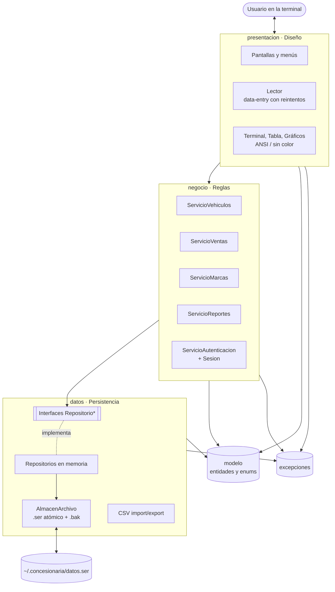
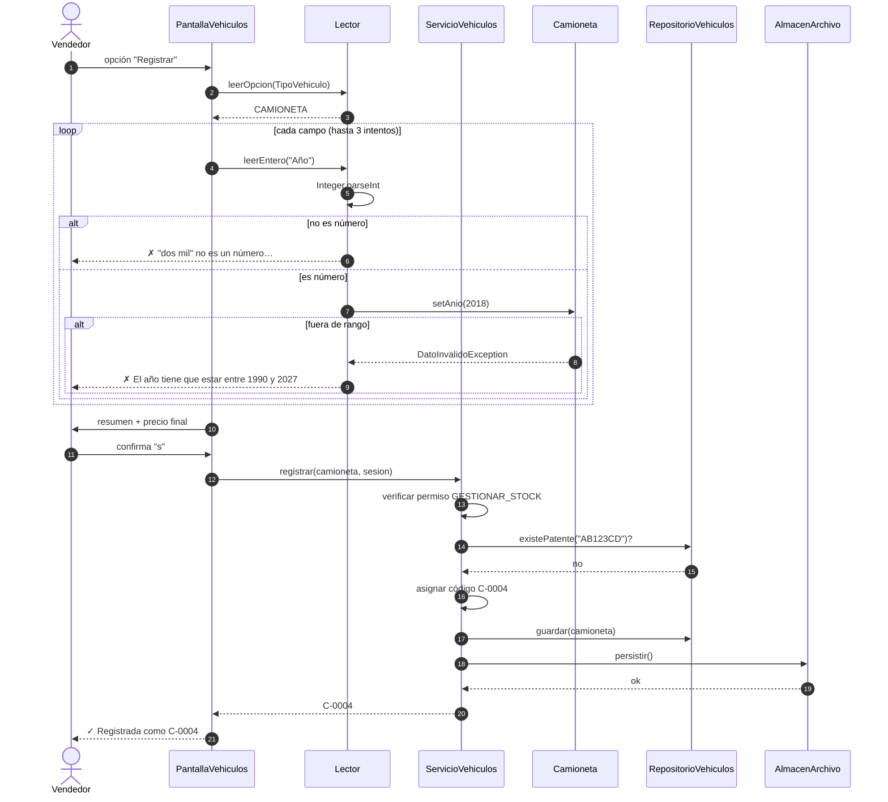
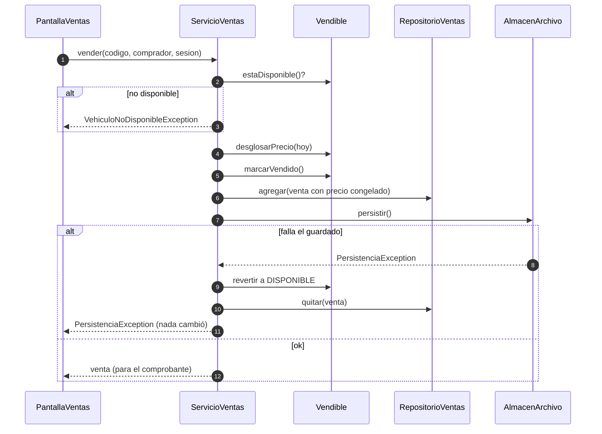
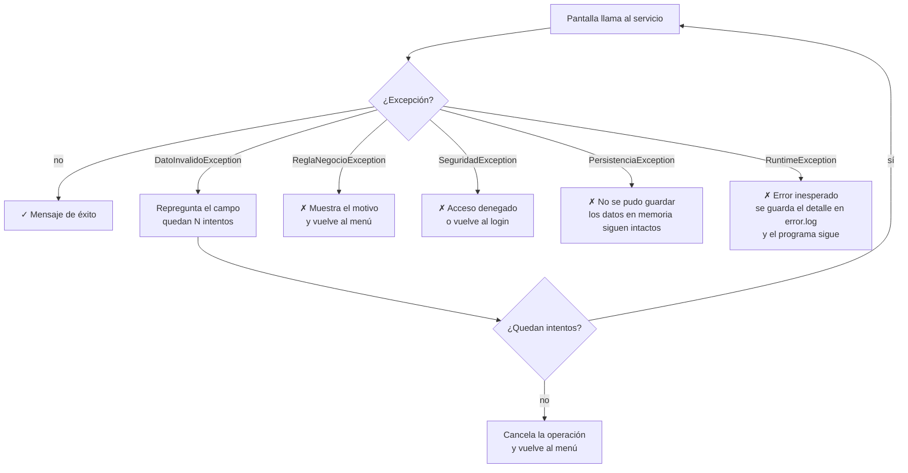
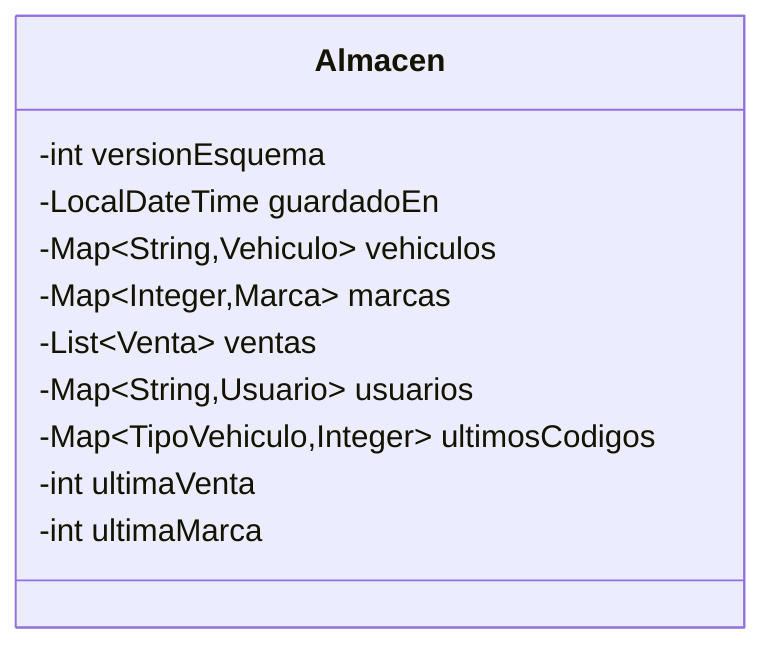
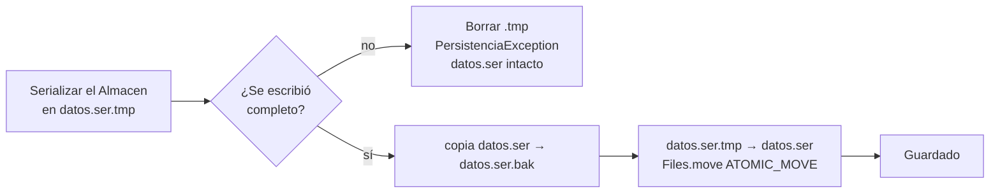
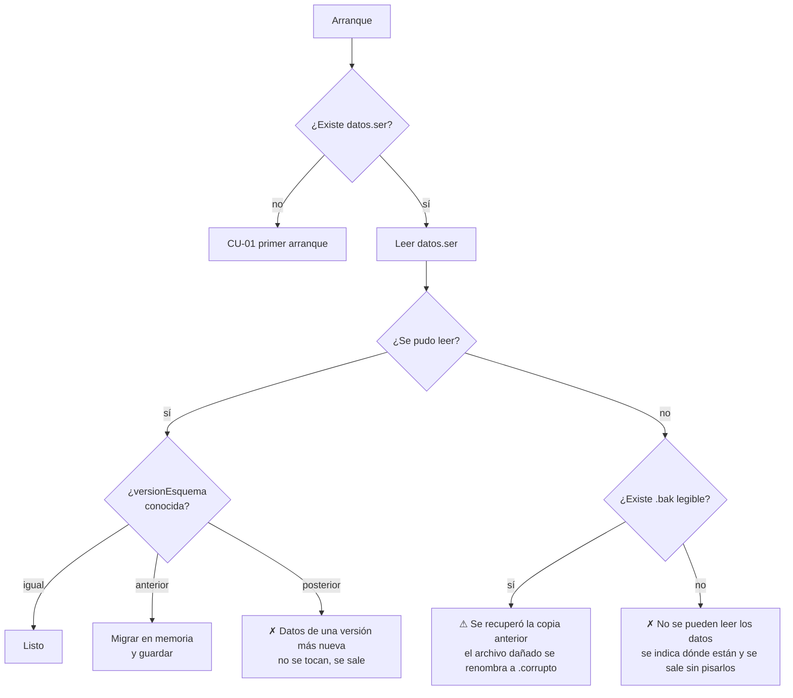
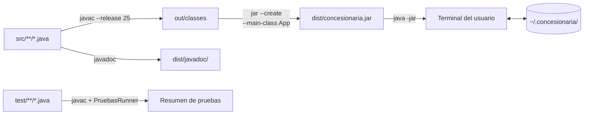

# Arquitectura

Cómo está organizado el sistema, cómo fluye una operación, cómo se guardan los datos y cómo
se mide el rendimiento. Pensado para responder preguntas en la defensa.

---

## 1. Vista general: Diseño vs. Negocio



El negocio usa cuatro interfaces de `datos`: los `Repositorio*`, `Persistencia` (guardar y
saber si hay cambios pendientes), `ArchivosExportacion` (CSV y TXT por nombre, sin rutas ni
`java.io`) y `CargadorDemo`. `RegistroErrores` llega a la consola como un
`Consumer<Throwable>` que arma `App`, así la consola no importa `datos`.

**La regla de dependencias:** las flechas van en un solo sentido. La consola conoce al negocio;
el negocio conoce solo las **interfaces** de los repositorios, nunca el archivo. Nada del
negocio importa `java.io` ni imprime en pantalla.

Esto permite:
- cambiar el archivo `.ser` por MySQL escribiendo otra implementación de las interfaces, sin
  tocar el negocio ni la consola;
- probar el negocio con repositorios en memoria, sin archivos;
- sumar otra interfaz (Swing, una API) sobre el mismo negocio.

La clase `App` (el `main`) es la única que conoce todas las piezas. Crea los repositorios, se
los pasa a los servicios, y pasa los servicios a la consola. Así cada clase recibe sus
dependencias por constructor en lugar de crearlas: es inyección de dependencias a mano, sin
framework.

---

## 2. Paquetes

```
ar.edu.utn.frre.concesionaria
├── App                    main: arma las dependencias y arranca la consola
├── presentacion           todo lo que imprime o lee del teclado
│   ├── consola            Terminal, Estilo (ANSI), Tabla, GraficoBarras, Lector,
│   │                      OperacionCancelada, FinDeEntrada
│   └── pantallas          Entorno, Pantalla (base), Vistas, PantallaInicio, MenuPrincipal,
│                          Vehiculos, Ventas, Marcas, Usuarios, Reportes, Datos
├── negocio                servicios (Autenticacion, Vehiculos, Ventas, Marcas, Reportes,
│                          Archivos), Sesion, Claves, FiltroVehiculos, OrdenVehiculos
├── datos                  interfaces Repositorio*, Persistencia, ArchivosExportacion,
│                          CargadorDemo; implementaciones en memoria, AlmacenArchivo,
│                          MigradorAlmacen, ArchivosCsv, DatosDemo, RegistroErrores
├── modelo                 Vehiculo y subclases, Marca, Venta, Usuario, enums
├── excepciones            jerarquía ConcesionariaException
└── comun                  Textos (normalizar, sin acentos), Formatos (moneda, km, fecha)
```

| Paquete | Puede usar | No puede usar |
|---|---|---|
| `presentacion` | negocio, modelo, excepciones, comun | datos |
| `negocio` | interfaces de datos, modelo, excepciones, comun | presentacion, `java.io` |
| `datos` | modelo, excepciones, comun | negocio, presentacion |
| `modelo` | excepciones, comun | todo lo demás |

---

## 3. Flujo de una operación

### Registrar un vehículo (CU-03)



El objeto se valida **mientras se carga**, campo por campo (los setters validan), para
repreguntar enseguida. El servicio vuelve a validar lo que necesita mirar el conjunto: la
patente única y los permisos.

### Vender (CU-10): todo o nada



Si el disco falla a mitad de una venta, el sistema deshace en memoria lo que había cambiado.
Nunca queda un vehículo vendido sin venta registrada, ni al revés.

### Manejo de errores en la consola



El `catch` va de lo específico a lo general. Una excepción no prevista nunca tira abajo el
programa ni muestra un *stack trace* al usuario: se registra en `~/.concesionaria/error.log`.

---

## 4. Persistencia

### Qué se guarda
Un solo archivo con una "foto" (*snapshot*) de todo el sistema:



`ResultadoImportacion` (vehículos leídos y errores por línea) vive en `modelo` porque lo
recorren las tres capas: lo arma `datos`, lo completa el negocio y lo muestra la consola.

¿Por qué un archivo y no uno por colección? Porque una venta modifica dos colecciones a la
vez (vehículos y ventas). Con un solo archivo, guardar es una operación única: o queda todo o
no queda nada. Con dos archivos, un corte entre el primero y el segundo dejaría los datos
inconsistentes.

### Guardado atómico



El `.tmp` se fuerza al disco (`FileDescriptor.sync()`) antes de moverlo. Si el sistema de
archivos no soporta el movimiento atómico, se reemplaza igual y el `.bak` cubre el hueco.
En ningún momento el archivo principal está a medio escribir. Si la luz se corta en
cualquier paso, queda la versión anterior completa en `datos.ser` o en `datos.ser.bak`.

### Carga y recuperación



### Compatibilidad entre versiones del `.jar`
- Cada clase serializable tiene un `serialVersionUID` fijo. Agregar un campo nuevo no rompe
  la lectura de archivos viejos: el campo nuevo llega en `null`, y por eso se usan wrappers.
- `versionEsquema` cubre los cambios que sí rompen. La migración se hace en código, en un
  único lugar (`MigradorAlmacen`).
- Como respaldo independiente del formato binario, existe la exportación a CSV (CU-15).

---

## 5. Seguridad

- Las claves no se guardan. Se guarda `SHA-256(sal + clave)` y una sal aleatoria de 16 bytes
  por usuario (`SecureRandom`). Dos usuarios con la misma clave tienen hashes distintos.
- El login no distingue "usuario inexistente" de "clave incorrecta", para no revelar qué
  usuarios existen.
- Los permisos se verifican en el negocio (`Sesion.exigir(Permiso)`), no solo en el menú.
- Limitación conocida, dicha de frente: SHA-256 con sal es suficiente para este alcance; un
  sistema real usaría un algoritmo lento como bcrypt o Argon2, que no vienen en el JDK.

---

## 6. Build y ejecución



| Comando | Qué hace |
|---|---|
| `./build.sh` | Compila y arma `dist/concesionaria.jar` |
| `./build.sh run` | Compila y ejecuta |
| `./build.sh test` | Compila y corre todas las pruebas |
| `./build.sh test PR-PRECIO` | Corre un solo grupo de pruebas |
| `./build.sh docs` | Genera el JavaDoc en `dist/javadoc/` |
| `./build.sh bench` | Corre las mediciones de rendimiento |
| `java -jar dist/concesionaria.jar --sin-color` | Ejecuta sin códigos ANSI |
| `java -Dconcesionaria.dir=/tmp/demo -jar …` | Usa otra carpeta de datos (para demos y pruebas) |

Sin Maven ni Gradle: `javac`, `jar` y `javadoc` vienen con el JDK, y es lo que se usó en el
curso (`run.sh`).

---

## 7. Rendimiento

### Estructuras elegidas y su costo

| Operación | Estructura | Costo | Alternativa descartada |
|---|---|---|---|
| Buscar vehículo por código | `HashMap<String, Vehiculo>` | O(1) | `ArrayList`: O(n) recorriendo |
| ¿Patente repetida? | `HashMap<String, String>` patente → código | O(1) | Recorrer el stock: O(n) por cada alta |
| Buscar marca por prefijo ("toy") | `TreeMap<String, Marca>` + `subMap` | O(log n + k) | Filtrar todas: O(n) |
| Listar con filtros | `stream().filter().sorted()` | O(n log n) | Inevitable: hay que mirar todo |
| Historial de ventas | `ArrayList<Venta>` (se agrega al final) | O(1) agregar | Ya queda en orden cronológico |
| Reportes por tipo o marca | `Collectors.groupingBy` | O(n), una pasada | Un recorrido por cada grupo |
| Guardar | Serializar todo el `Almacen` | O(n) | Ver nota abajo |

Nota sobre el guardado: guardar todo en cada cambio es O(n). Una concesionaria tiene cientos
o miles de unidades, no millones, así que lo simple alcanza de sobra. Las mediciones de abajo
lo confirman con números. Si no alcanzara, el siguiente paso sería un
guardado incremental o una base de datos.

### Objetivos
| Escenario | Objetivo |
|---|---|
| Arranque con 10.000 vehículos | < 1 s |
| Buscar por código con 100.000 | < 1 ms |
| Listar y ordenar 10.000 con filtros | < 100 ms |
| Guardar con 10.000 vehículos | < 500 ms |

### Cómo se mide
`./build.sh bench` corre la clase `MedicionRendimiento`:
- genera datos sintéticos con una semilla fija (siempre los mismos);
- hace 5 vueltas de calentamiento antes de medir, para que el JIT de la JVM optimice el código
  y no se mida la compilación;
- mide con `System.nanoTime()` (no con `currentTimeMillis`, que no es preciso para intervalos);
- informa la mediana de 20 repeticiones (la mediana no se deja llevar por una vuelta lenta
  aislada);
- compara `HashMap` contra `ArrayList` para la búsqueda por código con 1.000, 10.000 y
  100.000 vehículos, que es la demostración de por qué se eligió cada estructura.

### Resultados

Medido el 18/11/2026 en una Apple M4 (10 núcleos, macOS), JVM 27 ejecutando bytecode
compilado con `--release 25`. Mediana de 20 repeticiones tras 5 de calentamiento.

| Escenario | Medido | Objetivo |
|---|---:|---:|
| Guardar con 10.000 vehículos (archivo de 1.439 KB) | 12,6 ms | < 500 ms |
| Arranque (leer el archivo y armar índices) con 10.000 | 13,4 ms | < 1 s |
| Listar 10.000, filtrar camionetas y ordenar por precio | 2,6 ms | < 100 ms |
| Listar 10.000 sin filtro, orden natural | 7,1 ms | < 100 ms |
| Búsqueda de texto libre en 10.000 | 10,5 ms | — |

Buscar por código, 1.000 búsquedas al azar:

| Vehículos | `HashMap` | `ArrayList` | Relación |
|---:|---:|---:|---:|
| 1.000 | 0,040 ms | 0,778 ms | ×19 |
| 10.000 | 0,049 ms | 10,091 ms | ×206 |
| 100.000 | 0,037 ms | 155,813 ms | ×4.211 |

```text
ArrayList  1.000   ▏ 0,8 ms
          10.000   █ 10,1 ms
         100.000   ███████████████ 155,8 ms
HashMap   (las tres)  ▏ 0,04 ms: no cambia con la cantidad
```

El `HashMap` tarda lo mismo con 1.000 que con 100.000 (O(1)); el `ArrayList` crece en
proporción a la cantidad (O(n)). Con 100.000 vehículos, una búsqueda en el `HashMap` tarda
unos 37 nanosegundos: muy por debajo del objetivo de 1 ms.

**Lo que encontró la medición.** La primera corrida dio 89 ms para el listado en orden
natural, al borde del objetivo. El comparador normalizaba el nombre de la marca (quitar
acentos con `Normalizer` y una expresión regular) en cada una de las ~130.000 comparaciones
del ordenamiento. Se guardó la clave normalizada en un campo `transient` de `Marca`
(calculada una sola vez) y el modelo pasó a compararse con `String.CASE_INSENSITIVE_ORDER`:
el listado bajó a 7 ms, más de diez veces más rápido.

Conclusión: guardar todo el almacén en cada cambio (O(n)) cuesta 13 ms con 10.000 unidades,
así que la decisión de la sección 4 se sostiene con margen.

Limitación conocida: es una medición casera. La herramienta profesional es JMH, que es una
librería externa y queda fuera del alcance.
