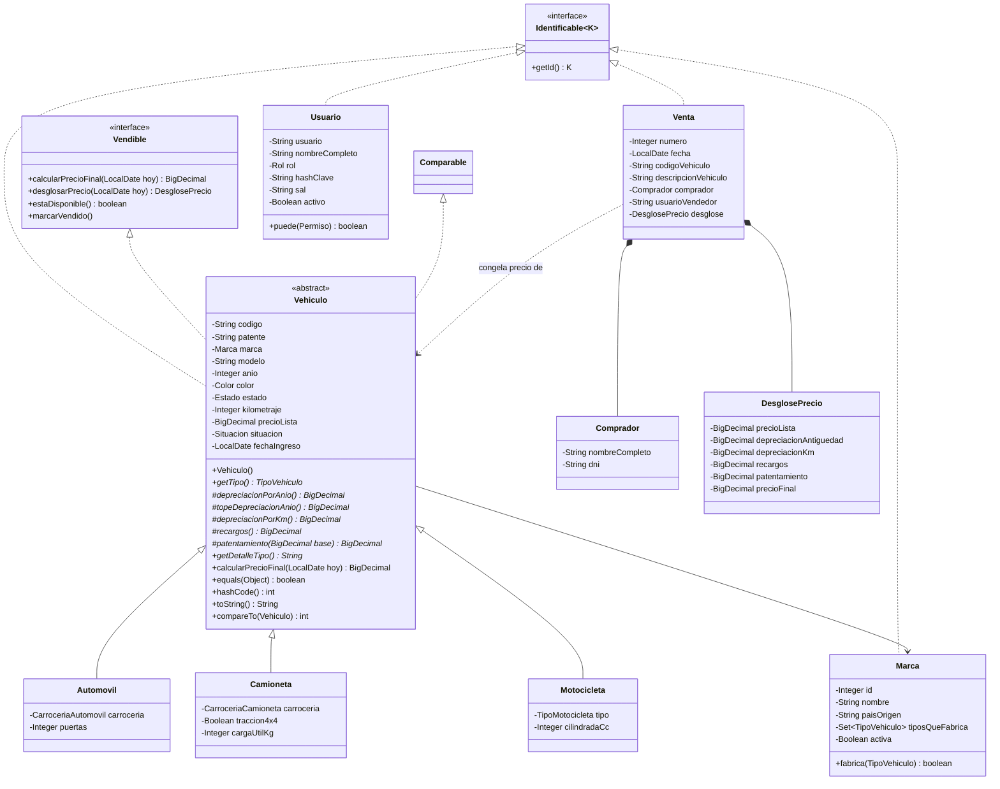
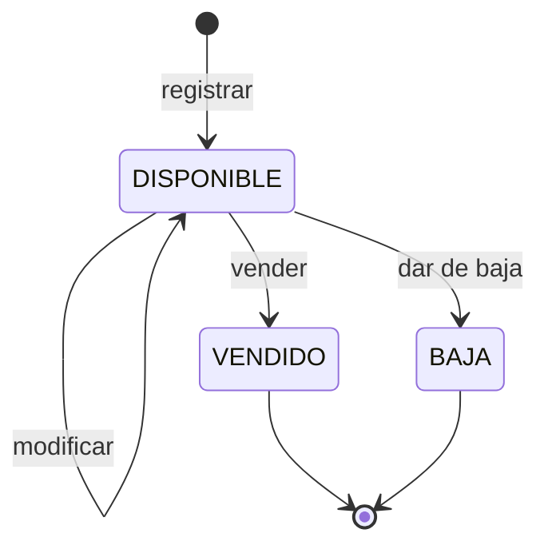
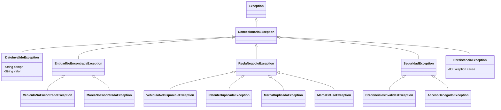

# Modelo del dominio

Las clases del paquete `modelo`, sus reglas y por qué están diseñadas así. La arquitectura
completa está en [ARQUITECTURA.md](ARQUITECTURA.md).

Paquete raíz: `ar.edu.utn.frre.concesionaria`.

---

## 1. Diagrama de clases

Todas las clases del modelo implementan `Serializable` y tienen un `serialVersionUID` fijo.

### Enums

```mermaid
classDiagram
    direction LR
    class TipoVehiculo {
        <<enum>>
        AUTOMOVIL
        CAMIONETA
        MOTOCICLETA
        +getPrefijo() char
    }
    class Estado {
        <<enum>>
        NUEVO
        USADO
    }
    class Situacion {
        <<enum>>
        DISPONIBLE
        VENDIDO
        BAJA
    }
    class Color {
        <<enum>>
        BLANCO
        NEGRO
        GRIS
        PLATA
        ROJO
        AZUL
        VERDE
        BORDO
        BEIGE
    }
    class CarroceriaAutomovil {
        <<enum>>
        SEDAN
        HATCHBACK
        RURAL
        COUPE
        CONVERTIBLE
    }
    class CarroceriaCamioneta {
        <<enum>>
        PICKUP_CABINA_SIMPLE
        PICKUP_DOBLE_CABINA
        SUV
        UTILITARIO
    }
    class TipoMotocicleta {
        <<enum>>
        CALLE
        NAKED
        DEPORTIVA
        TOURING
        ENDURO
        SCOOTER
        CUSTOM
    }
    class Rol {
        <<enum>>
        ADMINISTRADOR
        VENDEDOR
        DIRECTIVO
        +getPermisos() Set~Permiso~
    }
    class Permiso {
        <<enum>>
        VER_STOCK
        GESTIONAR_STOCK
        VENDER
        VER_VENTAS
        VER_REPORTES
        GESTIONAR_MARCAS
        GESTIONAR_USUARIOS
        EXPORTAR
        IMPORTAR
    }
```

Cada enum tiene un campo `etiqueta` para mostrar ("Doble cabina", "Pick-up cabina simple")
y un método estático `desdeTexto(String)` que tolera mayúsculas y acentos. `TipoVehiculo`
además sabe su prefijo de código (A, C, M) y `Rol` sabe sus permisos: la matriz de la spec
está escrita una sola vez, en el enum.

---

## 2. Decisiones del modelo

### Herencia y polimorfismo: *template method* para el precio
`Vehiculo.calcularPrecioFinal()` es un método **concreto y `final`** que arma la fórmula común
([SPEC §4](SPEC.md#4-reglas-de-precio)). Los porcentajes los pide a métodos **abstractos** que
cada subclase resuelve distinto (`depreciacionPorAnio()`, `recargos()`, `patentamiento()`).

¿Por qué así y no un `calcularPrecioFinal()` abstracto escrito tres veces? Porque la fórmula
es una sola. Si cada subclase la reescribe, aparecen tres versiones que divergen con el tiempo.
Este es el patrón *Template Method*: el algoritmo está en la clase base y los pasos variables
en las subclases.

El otro método polimórfico es `getDetalleTipo()`: "Doble cabina · 4x4 · 1.000 kg",
"Sedán · 4 puertas", "Naked · 471 cc". La tabla del stock lo usa sin saber qué tipo de
vehículo está mostrando.

### Interfaces: transmisión del comportamiento
- **`Vendible`**: lo que el negocio necesita para cotizar y vender. `ServicioVentas` trabaja
  con `Vendible`, no con `Vehiculo`. Si mañana se vendieran accesorios, implementarían
  `Vendible` y la venta no cambiaría.
- **`Identificable<K>`**: todo lo que se guarda tiene un id. Es la base del repositorio
  genérico `Repositorio<T extends Identificable<K>, K>`, así se escribe una vez el código de
  guardar, buscar y listar.
- **`Comparable<Vehiculo>`**: orden natural por tipo, marca, modelo y código. Los otros órdenes
  (precio, año, km) son `Comparator` armados con `Comparator.comparing(...).thenComparing(...)`.

### JavaBean y POJO
Las entidades (`Vehiculo` y subclases, `Marca`, `Venta`, `Usuario`, `Comprador`) son JavaBeans:
- constructor público sin argumentos (lo usan la serialización y el importador CSV);
- atributos `private` con getters y setters;
- `Serializable`.

Además tienen constructores con argumentos encadenados con `this(...)` y `super(...)`.

Los setters **validan** y lanzan `DatoInvalidoException`. Así un objeto del modelo nunca queda
en un estado inválido, venga el dato de la consola, del CSV o de una prueba. Los objetos de
valor (`DesglosePrecio`, `Comprador`) son POJOs inmutables: todos los campos `final`, sin
setters.

### Wrappers
- `Integer` para año, kilometraje, puertas, carga y cilindrada; `Boolean` para 4x4 y activa.
  Se usan wrappers y no primitivos porque **`null` significa "todavía no cargado"**, algo que
  un `int` no puede expresar (su valor por defecto 0 es un dato válido de kilometraje).
- `Integer.parseInt` / `Integer.valueOf` en la lectura de la consola, con la
  `NumberFormatException` traducida a `DatoInvalidoException`.
- Autoboxing en las colecciones: `Map<TipoVehiculo, Integer>` en los reportes y
  `Map<Integer, Marca>` en el catálogo.

### equals, hashCode, toString y compareTo
| Clase | Igualdad por | Por qué |
|---|---|---|
| `Vehiculo` | `codigo` | Es el id que asigna el sistema y no cambia nunca |
| `Marca` | `nombre` normalizado (sin acentos, minúsculas) | Así "Toyota" y "TOYOTA" son la misma marca y el duplicado se detecta solo |
| `Venta` | `numero` | Correlativo único |
| `Usuario` | `usuario` | Nombre de usuario único |

La patente **no** forma parte del `equals` porque es opcional y se puede corregir. Su
unicidad la garantiza el repositorio con un índice aparte.

`toString()` devuelve una línea legible para depurar y para los logs. La consola no lo usa
para mostrar: tiene sus propias tablas.

---

## 3. Reglas del dominio

### Por tipo
| Tipo | Prefijo | Atributos propios | Rangos |
|---|---|---|---|
| Automóvil | A | carrocería, puertas | 2 a 5 puertas |
| Camioneta | C | carrocería, 4x4, carga útil | 300 a 3.500 kg |
| Motocicleta | M | tipo, cilindrada | 50 a 2.500 cc |

### Nuevo y usado
| | Nuevo (0 km) | Usado |
|---|---|---|
| Kilometraje | 0, no se pregunta | 1 a 999.999 |
| Año | Año actual − 1 o posterior | 1990 en adelante |
| Patente | Opcional (puede no estar patentado) | Obligatoria |
| Precio | + patentamiento | − depreciación |

La regla "0 km ⇔ kilometraje 0" la valida `Vehiculo.setKilometraje()` en función del estado.

### Situación del vehículo

Solo un vehículo `DISPONIBLE` se puede modificar, vender o dar de baja. Cualquier otra
transición lanza `VehiculoNoDisponibleException`, que dice en qué situación está.

---

## 4. Excepciones propias

- Son **checked** (extienden `Exception`): el compilador obliga a manejarlas. Como son errores
  esperables (un dato mal cargado, una patente repetida), no corresponde que sean de runtime.
- Se agrupan por importancia, como en `calculadorabase3`: la consola atrapa de lo específico a
  lo general y cada nivel tiene su tratamiento. Un `DatoInvalidoException` repregunta; un
  `ReglaNegocioException` muestra el motivo y vuelve al menú; un `PersistenciaException` avisa
  que no se pudo guardar y no pierde lo que está en memoria.
- `DatoInvalidoException` lleva el campo y el valor, para que la consola arme un mensaje
  preciso sin tener que parsear texto.
- `PersistenciaException` envuelve la `IOException` original (encadenamiento con `cause`), así
  la capa de negocio no depende de `java.io`.
